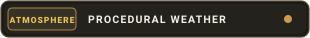

<div align="center">


<br/>


&nbsp;

&nbsp;


</div>

---

> **PROPRIETARY SOFTWARE — ALL RIGHTS RESERVED — STRICT ANTI-PLAGIARISM NOTICE**  
> This software, including its architecture, visual presentation concepts, quote database engine, and atmospheric weather algorithms, is the exclusive proprietary intellectual property of **Karlito Dev**. Any copying, code reuse, concept plagiarism, unauthorized distribution, or data mining is strictly prohibited.

A cross-platform native application built with **C# (.NET 9)** and **Avalonia UI**, engineered as a daily sanctuary for stoic discipline and strength of will.

---

### Philosophy & Scarcity

Forge is not a social feed or an endless scroll. It is a single-thought sanctuary: open the app, absorb the maxim, swipe, and return to reality.

- **One thought at a time**: No infinite scrolling, no cluttered lists.
- **Genuine scarcity**: Every viewed thought is consumed and will never appear again once the app is closed.
- **Absolute privacy**: Zero advertising SDKs, zero hardware identifiers, zero analytics or telemetry.
- **Visual sobriety**: Zero emojis across the entire interface to maintain stoic gravity, elegance, and focus.
- **Total source anonymity**: No author tags or external attributions. The insight confronts the user's mind directly without mediation.

---

<div align="center">


&nbsp;

&nbsp;


</div>

### Visual Design & Atmospheric Engine

The interface leverages **Avalonia UI** custom procedural vector and canvas rendering:

- **Glassmorphism Aesthetic**: Translucent frosted-glass cards with subtle specular borders, ambient depth, and mineral contrasts (`#F5F1E8`, `#1E1D1A`, `#C89B53`).
- **Procedural Animated Atmosphere**:
  - **Rain (`rain`)**: Dynamic angled raindrops drifting with variable wind velocity.
  - **Snow (`snow`)**: Soft snowflakes gently swaying along harmonic sinusoidal paths.
  - **Sunny (`sunny`)**: Gentle breathing radial pulse of a warm solar aura.
  - **Cloudy (`cloudy`)**: Low-opacity atmospheric mist drifting softly across the canvas.
- **100% Gesture-Driven Navigation (Touch Swipe)**:
  - Swipe Right (`→`): Forge the next unseen quote.
  - Swipe Left (`←`): Revisit previously viewed quotes from the current active session.
  - Interactive drag with dynamic angular tilt (`RotateTransform`) and opacity fading.

---

### The 10 Discipline Categories

Forge ships with a comprehensive seed of 70 quotes per language (210 quotes total across French, English, and Spanish) spanning 10 disciplines:

| Discipline | Category Focus | Character Forging |
| :--- | :--- | :--- |
| **Discipline** | Daily Rigor | Unwavering perseverance and mastery over impulse. |
| **Action** | Decisive Execution | Immediate action, refusing all forms of procrastination. |
| **Resilience** | Inner Fortitude | Enduring adversity and turning trial into strength. |
| **Stoicism** | Core Alignment | Relentless focus on what is within control. |
| **Ambition** | High Standards | Demanding more of oneself than of anyone else. |
| **Lucidity** | Mental Clarity | Cutting through illusion to see reality as it is. |
| **Calm** | Unshakeable Peace | Inner serenity in the very center of tumult. |
| **Detachment** | Complete Release | Freedom from external outcomes, opinion, and fortune. |
| **Philosophy** | Daily Practice | Living with integrity and unbending virtue. |
| **Poetic** | Noble Perspective | Deep appreciation for human existence and the brevity of time. |

---

### Architecture Overview

```
Forge/
├── Forge.Core/                 [Domain Logic & MVVM]
│   ├── Models/                 QuoteModel, QuoteCategory
│   ├── ViewModels/             MainViewModel, OnboardingViewModel, ViewModelBase
│   └── Repositories/           IQuoteRepository, IUserRepository, IBillingService, IWeatherService
├── Forge.Data/                 [Persistence & Local Storage]
│   ├── Local/                  ForgeDbContext (SQLite async), InitialQuotesSeed (210 quotes)
│   ├── Preferences/            PreferencesService (Encrypted key-value storage)
│   └── RemoteQuoteSource/      IRemoteQuoteSyncService (V1 signature stub ready for V2)
├── Forge.UI/                   [XAML Presentation & Controls]
│   ├── Controls/               WeatherAtmosphereControl (Procedural particle canvas)
│   ├── Views/                  MainView (Interactive swipe drag), OnboardingView (Gesture guide)
│   ├── Styles/                 ForgeTheme.axaml (Glassmorphism design tokens)
│   └── Assets/                 Official high-resolution category covers & logos
└── Forge.Android/              [Mobile Platform Head]
    ├── MainActivity.cs         Hardware FLAG_SECURE, Service container composition
    ├── AndroidManifest.xml     Permissions and security attributes
    └── Services/               AndroidBillingService (Google Play Billing v7.1.0)
```

---

<div align="center">


</div>

### Content Protection & Monétisation

- **Hardware Anti-Capture**: Enforced at the Android window level with `FLAG_SECURE` to block screenshots and screen recordings across all devices.
- **Secure Image Sharing**: No plain text is copied. Premium shares produce a curated image with an embedded 8% opacity cryptographic AI verification seal (`FORGE · SHA256`).
- **Google Play Billing**: Lifetime one-time purchase configured at **$3.99 USD** (`forge_premium_lifetime`) with dynamic multi-currency store lookup.

---

### Automated Cloud Compilation

The continuous integration workflow [`.github/workflows/avalonia-build.yml`](.github/workflows/avalonia-build.yml) builds the project on every push to the `avalonia` branch:
- Restores .NET 9 SDK and installs the Android workload.
- Builds `Forge.Core`, `Forge.UI`, and packages `Forge.Android`.
- Produces and archives the installable APK without consuming local developer machine RAM.

---

### Proprietary License & Anti-Plagiarism

This software is strictly proprietary and owned by **Karlito Dev** (see [LICENSE](LICENSE)):
- **Plagiarism and unauthorized replication strictly prohibited**.
- **All Rights Reserved** — Karlito Dev.
